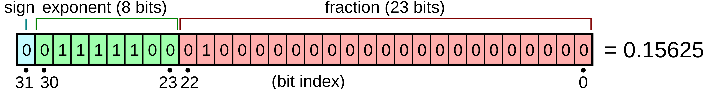

# Въведение в програмирането на C: Основни понятия

## 1. Именуване на променливи и конвенции

### Правила по стандарт C17

- **Символи:** Идентификаторите в C задължително започват с латинска буква (`a-z`, `A-Z`) или долна черта (`_`). Следващите символи могат да бъдат букви, цифри или долна черта.
- **Регистър:** Езикът C е **case-sensitive** (различава малки и главни букви).
- **Резервирани думи:** Не могат да се използват ключови думи за езика (като `int`, `return`, `float` и др.).

**Примери за валидни и невалидни имена:**

```c
int main() {
    // Валидни идентификатори ✅
    int var1;
    int _var2;
    int myVar3;
    long double big_var;
    float CapitalVar;

    // Невалидни идентификатори ❌
    // int skusaha_me-Brat; // Грешна употреба на тире '-'
    // int 2var;             // Започва с цифра

    return 0;
}
```

### Конвенции за именуване (`snake_case` спрямо `camelCase`)

В практиката се утвърждават различни стилове за писане на съставни имена:

- **`snake_case`**: Думите се разделят с долна черта (популярно в стандартната библиотека на C).
- **`camelCase`**: Всяка следваща дума започва с главна буква, без разделители.

---

## 2. scanf() и printf()

За четене от стандартния вход и писане в стандартния изход се използват съответно функциите scanf() и printf(), които се намират в stdio.h header файла.

### scanf(const char* format, ...)

Чете данни от стандартния вход stdin, обработва го спрямо форматиращия низ format и съхранява стойностите в подадените като аргументи променливи. Връща броят на успешно зададените стойности на аргументите.

#### Форматиращ низ
- Всеки символ освен whitespace символите (' ', '\n', ...) и '%' поглъща един идентичен символ от входа, като ако не съответстват, се брои за грешка. 
- Whitespace символите поглъщат всички последователни такива от входа, като се интерпретират по един и същи начин.
- Специално обръщане със следния формат:
    - въвеждащ символ '%'
    - модификатор на дължината (по желание)
    - форматиращ символ
- Форматиращи символи са следните:
    - '%' - литерала % (няма аргумент)
    - 'c' - символ
    - 's' - низ (аргументът е указател към началото му)
    - 'd' / 'i' - цяло число без знак
    - 'u' - цяло число със знак
    - 'o' - осмично число
    - 'x' - шестнайсетично число
    - 'f' - число с плаваща запетая
- На всяко специално обръщане съответства един аргумент, като стойността се съхранява в него.

### printf(const char* format, ...)

Зарежда данни от подадените променливи, обръща ги в низове и ги записва в стандартния изход във формата на форматиращия низ format. Връща броят записани символи или отрицателна стойност, ако има грешка.

#### Форматиращ низ
- Всички символи освен '%' се интерпретират нормално.
- Всяко срещане на '%' отново се счита за начало на специално обръщане със същия формат като при scanf(), като символът(ите) след него са как да интерпретираме съответния аргумент.

## Пример
```C
#include <stdio.h>

int main() {
    int a, b;

    scanf("%d %d", a, b):
    printf("%d %d", a, b);

    return 0;
}
```


## 3. Еволюция на целочислените типове в C

В ранните дни на езика C размерите на типовете са били тясно обвързани с хардуера:

- **16-битови машини:** Типът `int` е бил 16-битов (2 байта) като най-удобен за времето си.
- **32-битови машини:** С тяхното навлизане `int` става 32-битов. За съвместимост с по-малки стойности е въведена ключовата дума `short` (поне 16 бита).
- **64-битови машини:** Възникват различия в моделите (например `long` е 64-битов в Unix/Linux LP64, но остава 32-битов в Windows LLP64). За гарантиран поне 64-битов тип, стандартът C99 въвежда `long long`.

### Обобщение по стандарт C11

| Тип данни   | Минимален размер        |
| :---------- | :---------------------- |
| `short`     | $\ge 16$ бита (2 байта) |
| `int`       | $\ge 16$ бита (2 байта) |
| `long`      | $\ge 32$ бита (4 байта) |
| `long long` | $\ge 64$ бита (8 байта) |

---

## 4. Числа с плаваща запетая в C

### float


Стойността е равна на $(-1)^{sign} * 2^{exponent - exponent\_size + 1} * fraction$, където $fraction$ е стойността на мантисата в десетична форма, която се пресмята по следния начин:

$fraction = 1 + \sum_{i=1}^{mantissa\_size}2^{-i}.b_{mantissa\_size - i}$

В горния пример стойността е

$(-1)^{0}*2^{(124 -127)}*(1 + 2^{-2}) = 0.125*1.25 = 0.15625$

### double

Аналогично на float, но за експонентата имаме 11 бита, а за мантисата - 52.

## 5. Приоритет и асоциативност на операторите

### Приоритет на операциите

Приоритетът представлява формална йерархия, която определя реда на изпълнение на аритметичните и други операции в израз без изрични скоби.

**Пример за изчисление:**

```text
6 + 3 * 4 / 4 - 5
= 6 + ((3 * 4) / 4) - 5
= (6 + 3) - 5
= 4
```

### Асоциативност на операциите

Асоциативността определя посоката на изчисление (отляво надясно или отдясно наляво), когато в съседство са разположени операции с еднакъв приоритет.

- **Лява асоциативност** (характерна за събиране, изваждане, умножение и деление: `+`, `-`, `*`, `/`):

```text
5 - 7 - 4 - 2
= ((5 - 7) - 4) - 2
= -8
(което е различно от дясната асоциативност: 5 - (7 - (4 - 2)) = 0)
```
